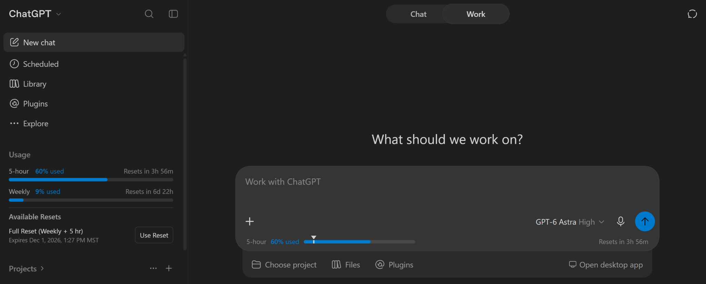
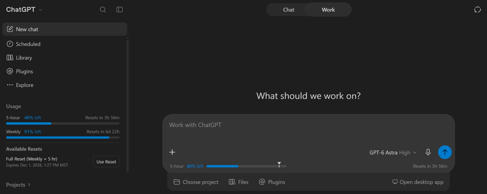

# Simple Usage Tracker for ChatGPT

See your ChatGPT usage limits, credits and available manual resets without leaving the chat. Inspired by [lugia19's Claude Usage Tracker](https://github.com/lugia19/Claude-Usage-Extension).

- A usage bar in the message box while you're in Work or Codex mode: your 5-hour usage, an arrow marking
  your weekly usage, and when the 5-hour limit resets (you can turn it off under "Options" in the
  toolbar popup)
- Show usage as used or left: switch between them under "Options" in the
  toolbar popup
- A Usage section in the sidebar, which you can collapse
- Available manual resets with expiration dates and a confirmation before use; hidden when none are available
- Your credit balance, and how many credits a message used when it was paid for with credits
- Updates on its own as you chat

## What's new in v1.0

The **Available Resets** section appears below your usage in the sidebar and toolbar popup when
your ChatGPT account has an unused, unexpired manual reset. Each reset shows its name and expiration
date in your local time zone. The section stays hidden when none are available; the extension
doesn't grant additional resets.

1. Open **Usage** in the sidebar or click the extension's toolbar icon.
2. Under **Available Resets**, click **Use Reset** beside the reset you want to use.
3. Click the green **Confirm** button to use it, or the red **Cancel** button to keep it.

Nothing is used until you confirm. The buttons appear side by side without shifting the reset's
name or expiration date. After you use a reset, usage and the available reset list refresh
automatically. If ChatGPT rejects the reset, the section shows the error.

The popup and sidebar use matching text colors in light and dark mode. In the popup, the update
time and refresh button sit below the usage bars, above the divider for **Available Resets**.

Not affiliated with or endorsed by OpenAI.

#### Developer note:
I really liked lugia19's extension for Claude, however I am transitioning to ChatGPT since it suits my needs better. But I couldn't find a good extension that is like lugia19's for ChatGPT, so I decided to basically entirely vibe code an entire extension for this reason (ironically mostly by Claude).
I don't plan to to actively maintain this extension, as this is just a something I wanted personally and I thought I would share to other people. I will just update it as I personally see fit.

## Install

**Chrome Web Store:**

**Manually:**
1. Download the latest zip from [Releases](../../releases) and unzip it.
2. Go to `chrome://extensions` and turn on **Developer mode**.
3. Click **Load unpacked** and choose the unzipped folder.

## Privacy Policy

**What it accesses:** While you're signed in to chatgpt.com, the extension uses your existing
ChatGPT session to read your usage limits, credit balance and available manual resets from chatgpt.com.
It can redeem a selected reset after you confirm. It does not read
your conversations, and it never sees your password.

**What it stores:** Your latest usage numbers and available resets (names, IDs and expiration dates), a running total of credits used per month, whether
the sidebar section is collapsed, whether to show the usage bar in the message box, whether to show
usage as used or left, whether to show release notes after updates, and a short troubleshooting
log. All of it is kept in your browser's
extension storage and is removed when you uninstall the extension.

**What it shares:** Nothing. The extension only communicates with chatgpt.com. It has no servers,
analytics or tracking, and no data is sold or transferred to anyone.

