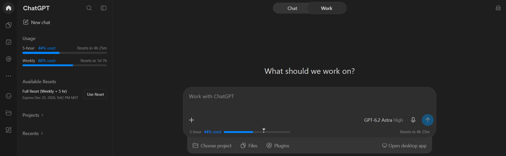
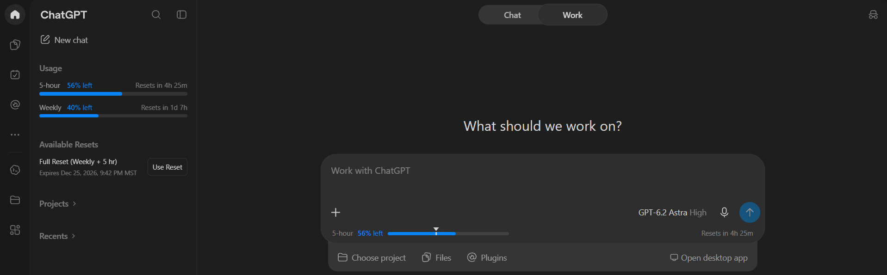

# Simple Usage Tracker for ChatGPT

See your ChatGPT usage limits, credits and available manual resets without leaving the chat. Inspired by [lugia19's Claude Usage Tracker](https://github.com/lugia19/Claude-Usage-Extension).




- A usage bar in the message box while you're in Work or Codex mode: your 5-hour usage, an arrow marking
  your weekly usage, and when the 5-hour limit resets (you can turn it off under "Options" in the
  toolbar popup)
- Show usage as used or left: switch between them under "Options" in the
  toolbar popup
- Hide ChatGPT's usage limit reached banner: turn it on or off under "Options" in the toolbar popup
- A collapsible Usage section in the Home and Codex sidebars, with available resets below a divider.
- Available manual resets with expiration dates and a confirmation before use (hidden when none are available)
- Your credit balance, and how many credits a message used when it was paid for with credits
- Updates on its own as you chat

Not affiliated with or endorsed by OpenAI.

#### "Developer" note:
I really liked lugia19's extension for Claude, however I am transitioning to ChatGPT since it suits my needs better. But I couldn't find a good extension that is like lugia19's for ChatGPT, so I decided to basically entirely vibe code an entire extension for this reason (ironically mostly by Claude).
I don't plan to to actively maintain this extension, as this is just a something I wanted personally and I thought I would share to other people. I will just update it as I personally see fit.

## Install

**Chrome Web Store:**

[](https://chromewebstore.google.com/detail/simple-usage-tracker-for/jidllgipcneeonigpfaljejnmjodhkga)
[](https://chromewebstore.google.com/detail/simple-usage-tracker-for/jidllgipcneeonigpfaljejnmjodhkga)

**Manually:**
1. Download the latest zip from [Releases](../../releases) and unzip it.
2. Go to `chrome://extensions` and turn on **Developer mode**.
3. Click **Load unpacked** and choose the unzipped folder.

## Optional Available Resets dropdown

By default, **Available Resets** appears below the bars in the collapsible **Usage** section.
If you have a long list of resets, you can give **Available Resets** its own collapsible section
with a command in the extension's DevTools console.

1. Open `chrome://extensions` and turn on **Developer mode**.
2. Find Simple Usage Tracker for ChatGPT and click **service worker** under Inspect views.
3. Run this command in the **Console** tab.

```js
chrome.storage.local.set({ separateResetsDropdown: true })
```

You can also open DevTools on `chatgpt.com`. In the **Console** tab, open the context dropdown
labeled **top** and select **Simple Usage Tracker for ChatGPT** before running the command.

To put **Available Resets** back under **Usage**, run the following in the same console.

```js
chrome.storage.local.set({ separateResetsDropdown: false })
```

The setting is saved and takes effect in open ChatGPT tabs automatically.

## Privacy Policy

**What it accesses:** While you're signed in to chatgpt.com, the extension uses your existing
ChatGPT session to read your usage limits, credit balance and available manual resets from chatgpt.com.
It can redeem a selected reset after you confirm. It does not read
your conversations, and it never sees your password.

**What it stores:** Your latest usage numbers and available resets (names, IDs and expiration dates), a running total of credits used per month, whether
each sidebar section is collapsed, whether resets use a separate dropdown, whether to show the usage bar in the message box, whether to hide
ChatGPT's usage-limit banner, whether to show usage as used or left,
whether to show release notes after updates, rate-limit retry and recovery timing, and a short troubleshooting
log. All of it is kept in your browser's
extension storage and is removed when you uninstall the extension.

**What it shares:** Nothing. The extension only communicates with chatgpt.com. It has no servers,
analytics or tracking, and no data is sold or transferred to anyone.

