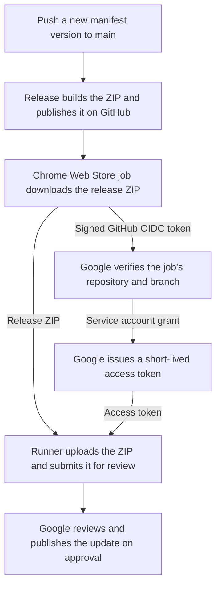

# Releasing

1. Add an entry for the new version at the top of `release-notes/changelog.json`, written for
   users. After the update, the extension opens it in a Release Notes tab (behind the current one),
   above the notes for earlier versions. A version without an entry updates quietly, which suits a
   small fix. Entries for versions newer than the manifest stay hidden, so notes can be written
   ahead.

   ```json
   {
     "version": "0.3.0",
     "date": "2026-10-05",
     "title": "An optional headline",
     "changes": [
       "One short, plain sentence per change, in sentence case."
     ]
   },
   ```

   It's JSON, so double quotes inside a change need a backslash (`\"`), and the last item in a
   list takes no comma. `npm run build` fails if the file doesn't parse.
2. Bump `version` in `manifest.json` and push it to the release branch (`main` in this repo).
3. The **Release** workflow sees the new version, tags the commit (`v0.2.0`), builds
   `simple-tracker-for-chatgpt-v0.2.0.zip` and publishes it as a GitHub release. Its notes are the
   version's entry from `release-notes/changelog.json` (`node scripts/release-notes.mjs` previews
   them), with the commits since the last release folded away below. A version without an entry
   lists just the commits. Publishing requires a version whose tag is new.
4. With Chrome Web Store publishing configured, **Release** uploads that same ZIP and submits it for
   review. Google publishes the update on approval. Until publishing is configured, upload the ZIP
   in the [Chrome Web Store Developer Dashboard](https://chrome.google.com/webstore/devconsole).

Each version is released once and never replaced, so ship a fix as a new version.

To build the ZIP locally, run `npm run build` with Node 22 or newer. It lands in `dist/`.

## How the release reaches the Chrome Web Store

The **Release** workflow calls the reusable **Chrome Web Store** workflow after the GitHub release
is published. In GitHub Actions, open the **Release** run and select **chrome-web-store / submit**
to see the automatic submission. Manual checks and retries started from the **Chrome Web Store**
workflow have their own runs. [Release workflow](.github/workflows/release.yml)
· [Chrome Web Store workflow](.github/workflows/chrome-web-store.yml)



OpenID Connect (OIDC) lets the runner present a token signed by GitHub with claims about the job,
such as the repository ID and branch. The **Workload Identity Pool** groups external identities
in Google Cloud. Its **OIDC provider** verifies GitHub's token and applies the repository and
branch condition. The attribute mappings give Google field names it can use when it evaluates
the token and the IAM grant.

The **service account** is the Google identity registered with the Chrome Web Store publisher.
The **Workload Identity User** grant lets a verified job from this repo act as that account.
Google then issues a temporary access token with Chrome Web Store scope, which the GitHub runner
sends along with its API requests. The publisher ID, service account email and provider path are
configuration identifiers, so they go in repository variables. The access token is the credential
and is generated during the run. [Google Cloud federation guide](https://cloud.google.com/iam/docs/workload-identity-federation-with-deployment-pipelines)

Edit the long listing description in the Developer Dashboard under **Store listing**. The short
summary comes from the `description` field in `manifest.json` and ships with the ZIP.
[Listing guide](https://developer.chrome.com/docs/webstore/cws-dashboard-listing)

## Set up automatic Chrome Web Store updates

### 1. Identify the GitHub repo and Store item

GitHub assigns each repository a numeric ID that stays the same when the repo is renamed. For
`TheBabu/Simple-Usage-Tracker-for-ChatGPT`, the ID is `1403874179`. Every fork gets its own ID.
Use your fork's owner and repository name to look up its ID with the GitHub CLI.

```sh
gh api repos/OWNER/REPOSITORY --jq '.id'
```

For a public repo, you can also open `https://api.github.com/repos/OWNER/REPOSITORY` and read
the top-level `id` field. Keep that number for both the provider condition in step 3 and the
service account grant in step 4. [GitHub repository API](https://docs.github.com/en/rest/repos/repos#get-a-repository)

The workflow uses `main` as the release branch. If your fork releases from a different branch,
update `on.push.branches` in `release.yml`, the `github.ref` check in `chrome-web-store.yml`,
and the Google condition in step 3 to match. [Release workflow](.github/workflows/release.yml)
· [Chrome Web Store workflow](.github/workflows/chrome-web-store.yml)

For a fork that publishes its own extension, create the Store item and upload the first version
in the Chrome Web Store Developer Dashboard. Copy its 32-character **item ID** from the
**Package** tab or the end of the public listing URL. In your fork's `chrome-web-store.yml`,
replace `jidllgipcneeonigpfaljejnmjodhkga` in the `item=` line with your item ID. This ID selects
the extension. The **publisher ID** in step 2 selects the account that owns it.
[Chrome Web Store API prerequisites](https://developer.chrome.com/docs/webstore/using-api#prerequisites)

### 2. Create and register the Google service account

In Google Cloud, select the project you want to use. If your Store publisher already has a
service account registered, use that account and its project throughout this setup. Open
**APIs & Services → Library**, then search for and enable these APIs.

- Chrome Web Store API
- Identity and Access Management (IAM) API
- IAM Service Account Credentials API
- Security Token Service API

To create the account, open **IAM & Admin → Service Accounts → Create service account**.
Give it a name such as `chrome-web-store-publisher` and leave the optional permissions and access
fields blank. If you started from the API's **Create credentials** wizard, choose **Application
data** to create a service account. Copy the full email address ending in
`.iam.gserviceaccount.com`.

In the Chrome Web Store Developer Dashboard, open **Account** and register the service account's
email if it's new. Then open **Publisher → Settings** and copy the publisher ID. Use the publisher
that owns the item from step 1. [Chrome Web Store service account setup](https://developer.chrome.com/docs/webstore/service-accounts)

### 3. Tell Google which GitHub jobs to trust

In the same Google Cloud project, go to **IAM & Admin → Workload Identity Federation** and
create a pool, for example `github-actions`. On **Add a provider to pool**, choose
**OpenID Connect (OIDC)** and give it a name such as **GitHub Actions**. The console shows the
generated provider ID below the name. Enter `https://token.actions.githubusercontent.com` as
the **Issuer URL**, leave **JWK file** blank, select **Default audience**, and click **Continue**.

On **Configure provider attributes**, enter `assertion.sub` in the first OIDC field next to
`google.subject`. Add two more mappings. Each row takes a value from the GitHub token and gives
it a field name Google can use.

| Google field | OIDC field | What it identifies |
|---|---|---|
| `google.subject` | `assertion.sub` | The external identity |
| `attribute.repository_id` | `assertion.repository_id` | The GitHub repository used in the grant |
| `attribute.ref` | `assertion.ref` | The Git ref checked by the condition |

Under **Attribute conditions** on that screen, paste the following expression. Replace
`REPOSITORY_ID` with the number from step 1 and `BRANCH` with your release branch name. Keep the
quotes and the `refs/heads/` prefix.

```text
assertion.repository_id == 'REPOSITORY_ID' && assertion.ref == 'refs/heads/BRANCH'
```

For the upstream repo, this is `assertion.repository_id == '1403874179' && assertion.ref == 'refs/heads/main'`.
`assertion` refers to claims in GitHub's signed token, and `&&` requires both claims to match.
`refs/heads/main` is Git's full ref for the branch named `main`. A fork's token carries the
fork's repository ID, so it must be configured with that ID even if its release branch is
also `main`. Save the provider. [Google Cloud federation guide](https://cloud.google.com/iam/docs/workload-identity-federation-with-deployment-pipelines)

If Google reports that the condition must reference a provider claim, check that you pasted
the expression into **Condition CEL** and added mappings for both `repository_id` and `ref`.

### 4. Grant the verified repo access to the service account

1. Open the pool's details page and click **Grant access** in the top bar, next to **Add provider**.
2. Choose **Service Account impersonation** and select the service account from step 2.
3. Choose **Only identities matching the filter**. Select `repository_id` as the attribute and
   enter the numeric repo ID from step 1 as the value. Click **Save**.
4. If **Configure your application** opens, click **Dismiss**. The GitHub workflow gets its
   token during the run. Back on the pool page, check **Connected service accounts** for the
   account you granted access to.

This grants `roles/iam.workloadIdentityUser` on the service account to the following principal
set. `PROJECT_NUMBER` is the numeric Google Cloud project number, shown after `/projects/` in
the pool details' **IAM principal** field. `POOL_ID` is the pool's **ID** on the same page.
`REPOSITORY_ID` is the GitHub number you just entered.

```text
principalSet://iam.googleapis.com/projects/PROJECT_NUMBER/locations/global/workloadIdentityPools/POOL_ID/attribute.repository_id/REPOSITORY_ID
```

[Google Cloud service account impersonation](https://cloud.google.com/iam/docs/workload-identity-federation-with-deployment-pipelines#service-account-impersonation)

### 5. Add the repository variables and verify the setup

In the GitHub repo that will run the workflow, open **Settings → Secrets and variables → Actions**.
On the **Variables** tab, use **New repository variable** for each entry.

| Variable | Value |
|---|---|
| `CWS_PUBLISHER_ID` | The publisher ID from step 2 |
| `CWS_SERVICE_ACCOUNT` | The full service account email from step 2 |
| `CWS_WORKLOAD_IDENTITY_PROVIDER` | `projects/PROJECT_NUMBER/locations/global/workloadIdentityPools/POOL_ID/providers/PROVIDER_ID` |

Use the project number and pool ID from step 4 and the provider ID from step 3 to fill in the
provider resource name. For example, a pool and provider both named `GitHub Actions` can each
have the ID `github-actions`. The full provider resource name ends in `/providers/github-actions`.

If GitHub prompts you to enable Actions on a fork, enable them from the **Actions** tab. Then
run the [read-only Store status check](#check-store-status-or-retry-a-submission) to verify the
setup before your next version bump.

## Check Store status or retry a submission

- **A variable is missing or empty.** The automatic Store job is skipped and the GitHub release
  still goes out. A manual run on the release branch names the missing variable in its
  configuration check.
- **A value or permission is wrong.** The Store job stops. In an automatic release, this marks
  the parent **Release** run failed. The GitHub release and ZIP have already been published.
  Open **chrome-web-store / submit** to see the authentication or API error.
- **The Store is already reviewing a version.** The job skips a duplicate submission for the same
  version. If a different version is in review or staged, the job stops before uploading.

To verify the current versions, go to **Actions → Chrome Web Store → Run workflow** and select
your release branch. Check **Show published and submitted versions** and leave the tag blank.
The workflow uses a read-only token and displays both revisions in the run summary.
`PENDING_REVIEW` means Google has the submitted version in review. The Developer Dashboard's
**Package** tab shows Draft and Published, and the **Status** tab shows review progress.

To retry after fixing the issue, run **Chrome Web Store** on your release branch with the existing
GitHub release tag and the status checkbox clear. If the upload succeeded and the submission failed,
check the draft version in the Developer Dashboard before retrying. The manual workflow uses the
ZIP attached to the existing GitHub release.
