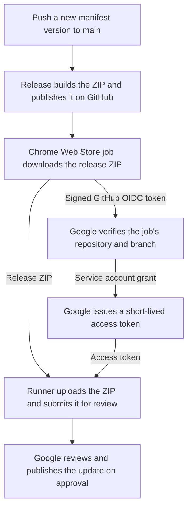

# Releasing

1. Add an entry for the new version at the top of `release-notes/changelog.json`, written for
   users. After the update, the extension opens it in a Release Notes tab (behind the current one),
   above the notes for earlier versions. A version without an entry updates quietly, which suits a
   small fix. Entries for versions newer than the manifest stay hidden, so notes can be written
   ahead.

   ```json
   {
     "version": "0.3.0",
     "date": "2026-10-05",
     "title": "An optional headline",
     "changes": [
       "One short, plain sentence per change, in sentence case."
     ]
   },
   ```

   It's JSON, so double quotes inside a change need a backslash (`\"`), and the last item in a
   list takes no comma. `npm run build` fails if the file doesn't parse.
2. Bump `version` in `manifest.json` and push it to `main`.
3. The **Release** workflow sees the new version, tags the commit (`v0.2.0`), builds
   `simple-tracker-for-chatgpt-v0.2.0.zip` and publishes it as a GitHub release. Its notes are the
   version's entry from `release-notes/changelog.json` (`node scripts/release-notes.mjs` previews
   them), with the commits since the last release folded away below. A version without an entry
   lists just the commits. Publishing requires a version whose tag is new.
4. With Chrome Web Store publishing configured, **Release** uploads that same ZIP and submits it for
   review. Google publishes the update on approval. Until publishing is configured, upload the ZIP
   in the [Chrome Web Store Developer Dashboard](https://chrome.google.com/webstore/devconsole).

Each version is released once and never replaced, so ship a fix as a new version.

To build the ZIP locally, run `npm run build` with Node 22 or newer. It lands in `dist/`.

## How the release reaches the Chrome Web Store

The **Release** workflow calls the reusable **Chrome Web Store** workflow after the GitHub release
is published. In GitHub Actions, open the **Release** run and select **chrome-web-store / submit**
to see the automatic submission. Manual checks and retries started from the **Chrome Web Store**
workflow have their own runs. [Release workflow](.github/workflows/release.yml)
· [Chrome Web Store workflow](.github/workflows/chrome-web-store.yml)



OpenID Connect (OIDC) lets the runner present a token signed by GitHub with claims about the job,
such as the repository ID and branch. The **Workload Identity Pool** groups external identities
in Google Cloud. Its **OIDC provider** verifies GitHub's token and applies the repository and
branch condition. The attribute mappings give Google field names it can use when it evaluates
the token and the IAM grant.

The **service account** is the Google identity registered with the Chrome Web Store publisher.
The **Workload Identity User** grant lets a verified job from this repo act as that account.
Google then issues a temporary access token with Chrome Web Store scope, which the GitHub runner
sends along with its API requests. The publisher ID, service account email and provider path are
configuration identifiers, so they go in repository variables. The access token is the credential
and is generated during the run. [Google Cloud federation guide](https://cloud.google.com/iam/docs/workload-identity-federation-with-deployment-pipelines)

Edit the long listing description in the Developer Dashboard under **Store listing**. The short
summary comes from the `description` field in `manifest.json` and ships with the ZIP.
[Listing guide](https://developer.chrome.com/docs/webstore/cws-dashboard-listing)

## Set up automatic Chrome Web Store updates

1. Enable the Chrome Web Store API, IAM, IAM Service Account Credentials and Security Token Service
   APIs in a Google Cloud project. Create a service account with the optional project roles left
   blank. If the credential wizard asks what data you will access, choose **Application data**.
   Add the service account email under **Account** in the Chrome Web Store Developer Dashboard.
   Copy your publisher ID from **Publisher → Settings** for step 4.
   [Chrome Web Store service account setup](https://developer.chrome.com/docs/webstore/service-accounts)
2. In Google Cloud, open **IAM & Admin → Workload Identity Federation**. Create a pool and add an
   **OpenID Connect (OIDC)** provider with issuer `https://token.actions.githubusercontent.com`
   and **Default audience**. Under **Configure provider attributes**, add these mappings.

   | Google attribute | OIDC claim |
   |---|---|
   | `google.subject` | `assertion.sub` |
   | `attribute.repository_id` | `assertion.repository_id` |
   | `attribute.ref` | `assertion.ref` |

   Under **Attribute conditions** on the same screen, paste this expression to restrict access
   to this repository's `main` branch.

   ```text
   assertion.repository_id == '1403874179' && assertion.ref == 'refs/heads/main'
   ```

3. Open the pool's details page and click **Grant access** next to **Add provider**. Choose
   **Service Account impersonation** and select the publishing service account. Choose
   **Only identities matching the filter**, set the attribute to `repository_id` and the value
   to `1403874179`, and save. Dismiss **Configure your application** if it opens. The GitHub
   action gets its OIDC token when it runs.

   This gives `roles/iam.workloadIdentityUser` on the service account to this principal set.

   ```text
   principalSet://iam.googleapis.com/projects/PROJECT_NUMBER/locations/global/workloadIdentityPools/POOL_ID/attribute.repository_id/1403874179
   ```

   [Google Cloud service account impersonation](https://cloud.google.com/iam/docs/workload-identity-federation-with-deployment-pipelines#service-account-impersonation)
4. Add these [GitHub Actions repository variables](https://github.com/TheBabu/Simple-Usage-Tracker-for-ChatGPT/settings/variables/actions).

   | Variable | Value |
   |---|---|
   | `CWS_PUBLISHER_ID` | The publisher ID from the Chrome Web Store Developer Dashboard |
   | `CWS_SERVICE_ACCOUNT` | The service account email registered in the dashboard |
   | `CWS_WORKLOAD_IDENTITY_PROVIDER` | `projects/PROJECT_NUMBER/locations/global/workloadIdentityPools/POOL_ID/providers/PROVIDER_ID` |

Once setup is complete, new GitHub releases go to the existing Store item
`jidllgipcneeonigpfaljejnmjodhkga`.

## Check Store status or retry a submission

- **A variable is missing or empty.** The automatic Store job is skipped and the GitHub release
  still goes out. A manual run on `main` names the missing variable in its configuration check.
- **A value or permission is wrong.** The Store job stops. In an automatic release, this marks
  the parent **Release** run failed. The GitHub release and ZIP have already been published.
  Open **chrome-web-store / submit** to see the authentication or API error.
- **The Store is already reviewing a version.** The job skips a duplicate submission for the same
  version. If a different version is in review or staged, the job stops before uploading.

To verify the current versions, go to **Actions → Chrome Web Store → Run workflow** on `main`.
Check **Show published and submitted versions** and leave the tag blank. The workflow uses a
read-only token and displays both revisions in the run summary. `PENDING_REVIEW` means Google has
the submitted version in review. The Developer Dashboard's **Package** tab shows Draft and
Published, and the **Status** tab shows review progress.

To retry after fixing the issue, run **Chrome Web Store** on `main` with the existing GitHub release
tag and the status checkbox clear. If the upload succeeded and the submission failed, check the
draft version in the Developer Dashboard before retrying. The manual workflow uses the ZIP attached
to the existing GitHub release.
